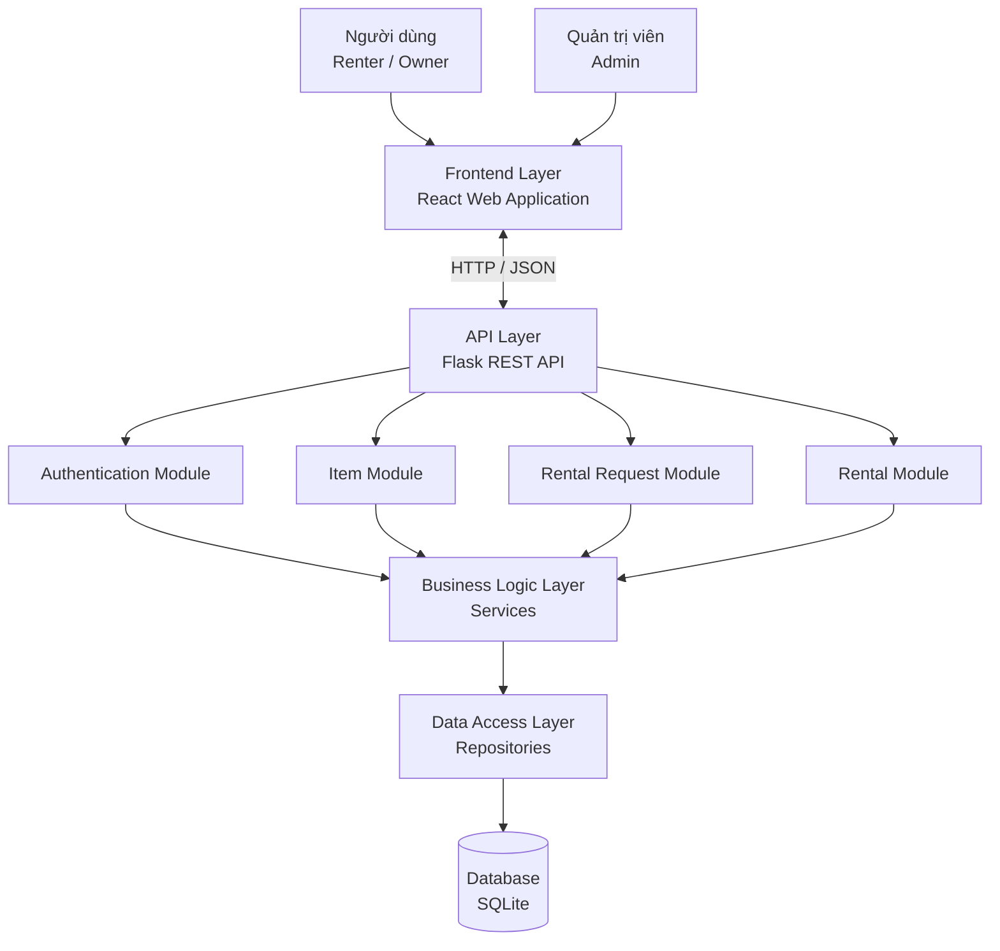

# RentMate — Kiến trúc hệ thống (System Architecture)

**Tuần 12 — Phân tích yêu cầu và thiết kế API (Design Review)**

---

## 1. Tổng quan kiến trúc

RentMate được thiết kế theo mô hình **Modular Monolith kết hợp Layered Architecture**.

Theo mô hình này, toàn bộ hệ thống Backend được triển khai dưới dạng một ứng dụng thống nhất, nhưng các chức năng nghiệp vụ được phân chia thành những module độc lập về trách nhiệm.

Mỗi module phụ trách một nhóm chức năng cụ thể, giúp mã nguồn dễ tổ chức, kiểm thử và bảo trì. Các module sử dụng chung cơ sở dữ liệu và giao tiếp thông qua các thành phần nghiệp vụ nội bộ.

Kiến trúc được lựa chọn nhằm đáp ứng các mục tiêu:

- Đơn giản hóa quá trình phát triển và triển khai.
- Phân tách rõ trách nhiệm giữa các thành phần.
- Hạn chế sự phụ thuộc không cần thiết giữa các module.
- Dễ dàng kiểm thử từng chức năng nghiệp vụ.
- Phù hợp với quy mô MVP và thời gian phát triển 4 tuần.
- Có khả năng mở rộng khi dự án phát triển trong tương lai.

## 2. Công nghệ sử dụng

| Thành phần | Công nghệ | Vai trò |
|---|---|---|
| Frontend | React | Xây dựng giao diện người dùng |
| Backend | Python Flask | Xây dựng REST API |
| API Specification | OpenAPI 3.0.3 | Định nghĩa API Contract |
| API Documentation | Swagger UI | Tài liệu và kiểm thử API |
| Database | SQLite | Lưu trữ dữ liệu MVP |
| API Testing | Postman / Swagger UI | Kiểm thử các endpoint |
| Contract Validation | Spectral | Kiểm tra chất lượng API Contract |
| Version Control | Git / GitHub | Quản lý mã nguồn và cộng tác |

## 3. Sơ đồ kiến trúc tổng thể

Hệ thống được tổ chức thành các thành phần chính:

- Client Layer: Tiếp nhận thao tác từ người dùng thông qua giao diện React.
- API Layer: Tiếp nhận HTTP Request, kiểm tra xác thực và điều phối yêu cầu.
- Business Layer: Xử lý các quy tắc nghiệp vụ của hệ thống.
- Data Access Layer: Thực hiện truy vấn và thao tác với cơ sở dữ liệu.
- Database Layer: Lưu trữ thông tin người dùng, đồ cho thuê và giao dịch.

## 4. Phân chia các module nghiệp vụ

Backend được chia thành bốn module chính, tương ứng với các nhóm tài nguyên trong Resource Model.

### 4.1. Authentication Module

**Trách nhiệm:** Quản lý tài khoản và xác thực người dùng.

Các chức năng:

- Đăng ký tài khoản.
- Đăng nhập.
- Kiểm tra thông tin xác thực.
- Phát hành Access Token.
- Xác định thông tin người dùng từ Token.

API chính:

- `POST /api/v1/auth/register`
- `POST /api/v1/auth/login`

### 4.2. Item Module

**Trách nhiệm:** Quản lý danh sách đồ dùng cho thuê.

Các chức năng:

- Tạo tin đăng đồ cho thuê.
- Lấy danh sách đồ dùng.
- Tìm kiếm và lọc đồ dùng.
- Xem chi tiết một món đồ.
- Cập nhật thông tin món đồ.
- Ngừng đăng tải món đồ.

API chính:

- `GET /api/v1/items`
- `POST /api/v1/items`
- `GET /api/v1/items/{itemId}`
- `PATCH /api/v1/items/{itemId}`
- `DELETE /api/v1/items/{itemId}`

Thao tác DELETE được xử lý theo cơ chế Soft Delete, tức là chuyển trạng thái món đồ sang INACTIVE thay vì xóa dữ liệu vật lý.

### 4.3. Rental Request Module

**Trách nhiệm:** Quản lý các yêu cầu thuê đồ dùng.

Các chức năng:

- Tạo yêu cầu thuê.
- Lấy danh sách yêu cầu thuê.
- Xem chi tiết yêu cầu.
- Chấp nhận yêu cầu thuê.
- Từ chối yêu cầu thuê.
- Kiểm tra tính hợp lệ của khoảng thời gian thuê.

API chính:

- `GET /api/v1/rental-requests`
- `POST /api/v1/rental-requests`
- `GET /api/v1/rental-requests/{requestId}`
- `PATCH /api/v1/rental-requests/{requestId}`

Khi một yêu cầu được chấp nhận, module này phối hợp với Rental Module để tạo giao dịch thuê tương ứng.

### 4.4. Rental Module

**Trách nhiệm:** Quản lý các giao dịch thuê đã được xác nhận.

Các chức năng:

- Lấy danh sách giao dịch.
- Xem thông tin giao dịch.
- Xác nhận bàn giao đồ dùng.
- Xác nhận hoàn trả đồ dùng.
- Cập nhật trạng thái giao dịch.

API chính:

- `GET /api/v1/rentals`
- `POST /api/v1/rentals/{rentalId}/handover`
- `POST /api/v1/rentals/{rentalId}/return`

## 5. Kiến trúc phân lớp (Layered Architecture)

Mỗi module nghiệp vụ được tổ chức theo các lớp có trách nhiệm riêng biệt.

### 5.1. Presentation Layer

Đây là lớp tiếp nhận và xử lý các yêu cầu HTTP.

Trách nhiệm:

- Tiếp nhận HTTP Request.
- Kiểm tra định dạng và dữ liệu đầu vào cơ bản.
- Kiểm tra xác thực và quyền truy cập.
- Gọi các hàm xử lý nghiệp vụ tương ứng.
- Trả về HTTP Response dưới dạng JSON.

Trong Flask, lớp này thường được triển khai bằng Routes hoặc Controllers.

### 5.2. Business Logic Layer

Đây là lớp xử lý các quy tắc nghiệp vụ của RentMate.

Trách nhiệm:

- Xử lý logic đăng ký và đăng nhập.
- Kiểm tra quyền sở hữu món đồ.
- Kiểm tra tính hợp lệ của yêu cầu thuê.
- Kiểm tra khoảng thời gian thuê có bị trùng lặp hay không.
- Xử lý chấp nhận hoặc từ chối yêu cầu.
- Quản lý vòng đời giao dịch thuê.

Lớp này được triển khai thông qua các Service.

### 5.3. Data Access Layer

Đây là lớp chịu trách nhiệm giao tiếp với cơ sở dữ liệu.

Trách nhiệm:

- Truy vấn thông tin người dùng.
- Lưu trữ và cập nhật thông tin món đồ.
- Truy xuất yêu cầu thuê.
- Tạo và cập nhật giao dịch thuê.
- Quản lý các thao tác đọc và ghi dữ liệu.

Lớp này được triển khai thông qua các Repository hoặc các thành phần truy cập dữ liệu tương đương.

### 5.4. Database Layer

Đây là lớp lưu trữ dữ liệu lâu dài của hệ thống.

Trong MVP, RentMate sử dụng SQLite với bốn bảng chính:

- `users`
- `items`
- `rental_requests`
- `rentals`

Các bảng được liên kết thông qua khóa chính và khóa ngoại nhằm đảm bảo tính toàn vẹn dữ liệu.

## 6. Luồng xử lý nghiệp vụ chính

### 6.1. Luồng tìm kiếm đồ dùng

1. Người dùng truy cập trang danh sách đồ dùng trên React.
2. Frontend gửi HTTP GET Request đến `/api/v1/items`.
3. Flask tiếp nhận yêu cầu tại Item Controller.
4. Item Service xử lý các điều kiện tìm kiếm và lọc.
5. Repository truy vấn dữ liệu từ SQLite.
6. Kết quả được trả về dưới dạng JSON.
7. Frontend hiển thị danh sách đồ dùng.

### 6.2. Luồng gửi yêu cầu thuê

1. Người thuê chọn một món đồ và nhập khoảng thời gian cần thuê.
2. Frontend gửi POST Request đến `/api/v1/rental-requests`.
3. API kiểm tra Access Token và xác định người dùng.
4. Rental Request Service kiểm tra thông tin món đồ.
5. Hệ thống kiểm tra ngày thuê và khả năng cho thuê.
6. Nếu dữ liệu hợp lệ, Repository lưu yêu cầu mới với trạng thái PENDING.
7. API trả về thông tin yêu cầu thuê vừa được tạo.

### 6.3. Luồng chấp nhận yêu cầu thuê

1. Chủ sở hữu xem danh sách yêu cầu thuê.
2. Chủ sở hữu chọn một yêu cầu đang ở trạng thái PENDING.
3. Frontend gửi yêu cầu cập nhật trạng thái đến API.
4. API xác thực người dùng và kiểm tra quyền sở hữu món đồ.
5. Rental Request Service kiểm tra trạng thái yêu cầu.
6. Hệ thống kiểm tra xung đột thời gian thuê.
7. Nếu hợp lệ, yêu cầu chuyển sang trạng thái APPROVED.
8. Rental Module tạo một giao dịch thuê mới với trạng thái CONFIRMED.
9. Hệ thống lưu dữ liệu và trả về kết quả.

Việc cập nhật yêu cầu và tạo giao dịch cần được thực hiện trong cùng một database transaction để tránh tình trạng yêu cầu đã được chấp nhận nhưng giao dịch không được tạo.

### 6.4. Luồng bàn giao và hoàn trả

**Bàn giao:**

1. Chủ sở hữu truy cập giao dịch đã được xác nhận.
2. Chủ sở hữu thực hiện thao tác xác nhận bàn giao.
3. API kiểm tra quyền truy cập và trạng thái giao dịch.
4. Hệ thống chuyển trạng thái từ CONFIRMED sang ACTIVE.

**Hoàn trả:**

1. Sau khi người thuê trả đồ, chủ sở hữu xác nhận hoàn trả.
2. API kiểm tra quyền truy cập và trạng thái giao dịch.
3. Hệ thống ghi nhận thời điểm hoàn trả.
4. Trạng thái giao dịch chuyển từ ACTIVE sang COMPLETED.

## 7. Thiết kế giao tiếp giữa các thành phần

Frontend và Backend giao tiếp thông qua REST API sử dụng giao thức HTTP.

Các phương thức HTTP chính:

| Phương thức | Mục đích | Ví dụ |
|---|---|---|
| GET | Lấy dữ liệu | `GET /api/v1/items` |
| POST | Tạo tài nguyên mới | `POST /api/v1/items` |
| PATCH | Cập nhật một phần tài nguyên | `PATCH /api/v1/items/{itemId}` |
| DELETE | Ngừng đăng tải tài nguyên | `DELETE /api/v1/items/{itemId}` |

Các quy ước trao đổi dữ liệu:

- Request và Response sử dụng JSON.
- Các API yêu cầu đăng nhập sử dụng Bearer Token.
- Mỗi endpoint cần định nghĩa rõ Request Schema và Response Schema.
- Các lỗi được trả về với HTTP Status Code phù hợp.
- API được mô tả tập trung trong OpenAPI Specification.

## 8. Các quyết định thiết kế và đánh đổi (Design Trade-offs)

### 8.1. Modular Monolith thay vì Microservices

**Lựa chọn:** Modular Monolith.

Lý do:

- Dự án có quy mô nhỏ và thời gian phát triển giới hạn.
- Các module nghiệp vụ có mối quan hệ chặt chẽ.
- Dễ triển khai và kiểm thử trong một ứng dụng thống nhất.
- Không cần thiết lập giao tiếp giữa nhiều dịch vụ độc lập.

Đánh đổi:

- Các module cùng chạy trong một ứng dụng.
- Khả năng mở rộng độc lập từng module còn hạn chế.
- Khi hệ thống lớn hơn, có thể cần tách một số module thành dịch vụ riêng.

### 8.2. SQLite thay vì PostgreSQL

**Lựa chọn:** SQLite cho MVP.

Lý do:

- Dễ thiết lập môi trường phát triển.
- Không cần triển khai database server riêng.
- Phù hợp với ứng dụng thử nghiệm có quy mô nhỏ.

Đánh đổi:

- Khả năng xử lý nhiều thao tác ghi đồng thời còn hạn chế.
- Không phù hợp với hệ thống có tải lớn.
- Có thể chuyển sang PostgreSQL khi hệ thống cần mở rộng.

### 8.3. OpenAPI Design-first

**Lựa chọn:** Thiết kế API Contract trước khi triển khai Backend.

Lý do:

- Giúp các thành viên thống nhất cách giao tiếp giữa Frontend và Backend.
- Xác định rõ endpoint, request, response và lỗi.
- Có thể kiểm tra API Contract trước khi hoàn thiện mã nguồn.
- Hỗ trợ tạo tài liệu và kiểm thử thông qua Swagger UI.

Đánh đổi:

- Cần thời gian thống nhất và cập nhật đặc tả.
- Khi thay đổi nghiệp vụ, API Contract cần được cập nhật đồng bộ với Backend.

### 8.4. Tách RentalRequest và Rental

**Lựa chọn:** Sử dụng hai tài nguyên độc lập.

Lý do:

- Phân biệt yêu cầu đang chờ xử lý với giao dịch đã được xác nhận.
- Quản lý vòng đời của yêu cầu và giao dịch riêng biệt.
- Dễ theo dõi lịch sử và trạng thái nghiệp vụ.

Đánh đổi:

- Cấu trúc dữ liệu phức tạp hơn.
- Cần đảm bảo thao tác chấp nhận yêu cầu và tạo giao dịch được thực hiện nhất quán.

## 9. Định hướng mở rộng trong tương lai

Sau khi hoàn thành MVP, hệ thống có thể được mở rộng theo các hướng:

- Chuyển database từ SQLite sang PostgreSQL.
- Bổ sung thanh toán trực tuyến.
- Tích hợp dịch vụ vận chuyển.
- Bổ sung hệ thống nhắn tin giữa người thuê và người cho thuê.
- Bổ sung chức năng đánh giá và nhận xét.
- Bổ sung xác minh danh tính người dùng.
- Tách các module thành Microservices nếu quy mô và nhu cầu vận hành thực sự yêu cầu.

## 10. Kết luận

Kiến trúc RentMate được xây dựng theo hướng Modular Monolith kết hợp Layered Architecture, với sự phân chia rõ ràng giữa giao diện người dùng, API, xử lý nghiệp vụ, truy cập dữ liệu và cơ sở dữ liệu.

Thiết kế này giúp hệ thống duy trì cấu trúc đơn giản, dễ phát triển và kiểm thử, đồng thời đáp ứng các yêu cầu nghiệp vụ cốt lõi trong phạm vi MVP.

Việc sử dụng REST API kết hợp OpenAPI Design-first tạo cơ sở để thống nhất API Contract giữa các thành viên và triển khai hệ thống theo từng module.
