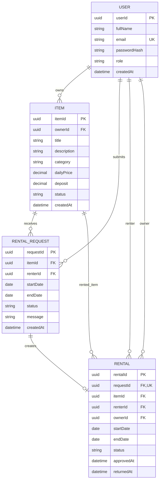

# RentMate — Sơ đồ thực thể và mối quan hệ (ERD)

**Tuần 12 — Phân tích yêu cầu và thiết kế API (Design Review)**

## 1. Tổng quan

Sơ đồ thực thể và mối quan hệ (Entity Relationship Diagram - ERD) mô tả cấu trúc dữ liệu và mối quan hệ giữa các thực thể trong hệ thống RentMate.

Dựa trên mô hình tài nguyên đã xác định, hệ thống sử dụng bốn thực thể chính:

- **User:** Lưu trữ thông tin tài khoản người dùng.
- **Item:** Lưu trữ thông tin các món đồ được đăng tải để cho thuê.
- **RentalRequest:** Lưu trữ các yêu cầu thuê do người dùng gửi.
- **Rental:** Lưu trữ thông tin các giao dịch thuê đã được xác nhận.

Mô hình dữ liệu được thiết kế nhằm hỗ trợ các chức năng chính của MVP, bao gồm quản lý tài khoản, đăng tải đồ cho thuê, gửi yêu cầu thuê, xử lý yêu cầu và theo dõi quá trình giao nhận, hoàn trả.

## 2. Sơ đồ ERD

## 3. Mô tả các thực thể

### 3.1. USER — Người dùng

Lưu trữ thông tin tài khoản của những người tham gia nền tảng RentMate.

| Thuộc tính | Kiểu dữ liệu | Ràng buộc | Mô tả |
|---|---|---|---|
| userId | UUID | PK | Định danh người dùng |
| fullName | VARCHAR | NOT NULL | Họ và tên |
| email | VARCHAR | UNIQUE, NOT NULL | Email đăng nhập |
| passwordHash | VARCHAR | NOT NULL | Mật khẩu đã mã hóa |
| role | VARCHAR | NOT NULL | Vai trò người dùng |
| createdAt | DATETIME | NOT NULL | Thời điểm tạo tài khoản |

**Các vai trò:**

- RENTER: Người thuê đồ.
- OWNER: Người sở hữu và cho thuê đồ.
- ADMIN: Người quản trị hệ thống.

Một người dùng có thể tham gia nhiều hoạt động thuê và cho thuê khác nhau. Vai trò người thuê hoặc người cho thuê trong từng giao dịch được xác định thông qua các khóa ngoại tương ứng.

### 3.2. ITEM — Đồ cho thuê

Lưu trữ thông tin các món đồ được người dùng đăng tải lên hệ thống.

| Thuộc tính | Kiểu dữ liệu | Ràng buộc | Mô tả |
|---|---|---|---|
| itemId | UUID | PK | Định danh món đồ |
| ownerId | UUID | FK, NOT NULL | Người sở hữu món đồ |
| title | VARCHAR | NOT NULL | Tên món đồ |
| description | TEXT | NULL | Mô tả món đồ |
| category | VARCHAR | NOT NULL | Danh mục |
| dailyPrice | DECIMAL | NOT NULL | Giá thuê mỗi ngày |
| deposit | DECIMAL | NOT NULL | Tiền đặt cọc |
| status | VARCHAR | NOT NULL | Trạng thái đăng tải |
| createdAt | DATETIME | NOT NULL | Thời điểm đăng tải |

**Khóa ngoại:**

- `ownerId` tham chiếu đến `USER.userId`.

**Trạng thái:**

- ACTIVE: Đang được đăng tải.
- INACTIVE: Đã ngừng đăng tải.

Một người dùng có thể sở hữu nhiều món đồ, nhưng mỗi món đồ chỉ thuộc về một người sở hữu.

### 3.3. RENTAL_REQUEST — Yêu cầu thuê

Lưu trữ thông tin các yêu cầu thuê được người dùng gửi đến chủ sở hữu món đồ.

| Thuộc tính | Kiểu dữ liệu | Ràng buộc | Mô tả |
|---|---|---|---|
| requestId | UUID | PK | Định danh yêu cầu |
| itemId | UUID | FK, NOT NULL | Món đồ được yêu cầu thuê |
| renterId | UUID | FK, NOT NULL | Người gửi yêu cầu |
| startDate | DATE | NOT NULL | Ngày bắt đầu thuê |
| endDate | DATE | NOT NULL | Ngày kết thúc thuê |
| status | VARCHAR | NOT NULL | Trạng thái yêu cầu |
| message | TEXT | NULL | Lời nhắn cho chủ sở hữu |
| createdAt | DATETIME | NOT NULL | Thời điểm tạo yêu cầu |

**Khóa ngoại:**

- `itemId` tham chiếu đến `ITEM.itemId`.
- `renterId` tham chiếu đến `USER.userId`.

**Trạng thái:**

- PENDING: Đang chờ xử lý.
- APPROVED: Đã được chấp nhận.
- REJECTED: Đã bị từ chối.
- CANCELLED: Đã bị hủy.

Một món đồ có thể nhận nhiều yêu cầu thuê. Một người dùng cũng có thể gửi nhiều yêu cầu thuê cho những món đồ khác nhau.

### 3.4. RENTAL — Giao dịch thuê

Lưu trữ thông tin các giao dịch thuê được hình thành sau khi chủ sở hữu chấp nhận yêu cầu thuê.

| Thuộc tính | Kiểu dữ liệu | Ràng buộc | Mô tả |
|---|---|---|---|
| rentalId | UUID | PK | Định danh giao dịch |
| requestId | UUID | FK, UNIQUE, NOT NULL | Yêu cầu thuê ban đầu |
| itemId | UUID | FK, NOT NULL | Món đồ được thuê |
| renterId | UUID | FK, NOT NULL | Người thuê |
| ownerId | UUID | FK, NOT NULL | Người cho thuê |
| startDate | DATE | NOT NULL | Ngày bắt đầu thuê |
| endDate | DATE | NOT NULL | Ngày kết thúc thuê |
| status | VARCHAR | NOT NULL | Trạng thái giao dịch |
| approvedAt | DATETIME | NOT NULL | Thời điểm xác nhận |
| returnedAt | DATETIME | NULL | Thời điểm hoàn trả |

**Khóa ngoại:**

- `requestId` tham chiếu đến `RENTAL_REQUEST.requestId`.
- `itemId` tham chiếu đến `ITEM.itemId`.
- `renterId` tham chiếu đến `USER.userId`.
- `ownerId` tham chiếu đến `USER.userId`.

**Trạng thái:**

- CONFIRMED: Giao dịch đã được xác nhận.
- ACTIVE: Đồ dùng đã được bàn giao và đang trong thời gian thuê.
- COMPLETED: Giao dịch đã hoàn tất.
- CANCELLED: Giao dịch đã bị hủy.

Thuộc tính `requestId` có ràng buộc UNIQUE nhằm đảm bảo một yêu cầu thuê không tạo ra nhiều giao dịch thuê.

## 4. Mô tả các mối quan hệ

| Mối quan hệ | Bội số | Ý nghĩa |
|---|---|---|
| USER - ITEM | 1:N | Một người dùng có thể sở hữu nhiều món đồ |
| USER - RENTAL_REQUEST | 1:N | Một người dùng có thể gửi nhiều yêu cầu thuê |
| ITEM - RENTAL_REQUEST | 1:N | Một món đồ có thể nhận nhiều yêu cầu thuê |
| RENTAL_REQUEST - RENTAL | 1:0..1 | Một yêu cầu thuê có thể tạo tối đa một giao dịch |
| USER - RENTAL (Renter) | 1:N | Một người dùng có thể tham gia nhiều giao dịch với vai trò người thuê |
| USER - RENTAL (Owner) | 1:N | Một người dùng có thể tham gia nhiều giao dịch với vai trò người cho thuê |
| ITEM - RENTAL | 1:N | Một món đồ có thể phát sinh nhiều giao dịch thuê theo các khoảng thời gian khác nhau |

## 5. Các ràng buộc dữ liệu và nghiệp vụ

Để đảm bảo tính toàn vẹn dữ liệu, hệ thống cần áp dụng các ràng buộc sau:

### 5.1. Ràng buộc khóa

- `userId`, `itemId`, `requestId` và `rentalId` là khóa chính của các bảng tương ứng.
- Email người dùng phải là duy nhất.
- Các khóa ngoại phải tham chiếu đến bản ghi tồn tại.
- `RENTAL.requestId` phải là duy nhất để tránh tạo nhiều giao dịch từ cùng một yêu cầu thuê.

### 5.2. Ràng buộc dữ liệu

- `fullName`, `email` và `passwordHash` không được để trống.
- `dailyPrice` phải lớn hơn 0.
- `deposit` phải lớn hơn hoặc bằng 0.
- `startDate` phải nhỏ hơn hoặc bằng `endDate`.
- `status` chỉ được nhận những giá trị đã định nghĩa.
- `returnedAt` chỉ được ghi nhận khi giao dịch đã thực hiện hoàn trả.

### 5.3. Ràng buộc nghiệp vụ

- Người sở hữu không được gửi yêu cầu thuê đối với chính món đồ của mình.
- Món đồ INACTIVE không được nhận yêu cầu thuê mới.
- Chỉ yêu cầu PENDING mới được chấp nhận hoặc từ chối.
- Một giao dịch chỉ được tạo sau khi yêu cầu thuê được chấp nhận.
- Không được tồn tại hai giao dịch APPROVED hoặc ACTIVE có khoảng thời gian thuê chồng lấn đối với cùng một món đồ.
- Việc ngừng đăng tải món đồ không được làm mất dữ liệu lịch sử giao dịch.

## 6. Giải thích các quyết định thiết kế

### 6.1. Tách RENTAL_REQUEST và RENTAL

Hai thực thể được tách riêng nhằm phân biệt quá trình yêu cầu thuê và giao dịch thuê thực tế.

- `RENTAL_REQUEST` quản lý yêu cầu do người thuê gửi và quyết định của chủ sở hữu.
- `RENTAL` quản lý giao dịch sau khi yêu cầu được chấp nhận, bao gồm bàn giao, sử dụng và hoàn trả.

Cách thiết kế này giúp hệ thống quản lý trạng thái và lịch sử của từng giai đoạn rõ ràng hơn.

### 6.2. Sử dụng khóa ngoại để đảm bảo tính liên kết

Các khóa ngoại đảm bảo những bản ghi liên quan luôn tham chiếu đến dữ liệu hợp lệ.

Ví dụ:

- Một Item phải thuộc về một User tồn tại.
- Một RentalRequest phải tham chiếu đến một Item và một người thuê tồn tại.
- Một Rental phải tham chiếu đến yêu cầu thuê, món đồ, người thuê và người cho thuê hợp lệ.

### 6.3. Không xóa vật lý dữ liệu món đồ

Khi chủ sở hữu muốn ngừng cho thuê, hệ thống chuyển trạng thái Item từ ACTIVE sang INACTIVE thay vì xóa bản ghi.

Điều này giúp bảo toàn các yêu cầu thuê và giao dịch đã phát sinh trước đó.

### 6.4. Kiểm tra trùng lặp thời gian thuê

Khi chủ sở hữu chấp nhận một yêu cầu thuê, hệ thống phải kiểm tra các giao dịch hiện có của cùng món đồ.

Nếu tồn tại giao dịch có khoảng thời gian thuê chồng lấn, hệ thống từ chối việc xác nhận để tránh một món đồ được cho thuê cho nhiều người trong cùng thời gian.

## 7. Kết luận

ERD của RentMate gồm bốn thực thể cốt lõi: USER, ITEM, RENTAL_REQUEST và RENTAL.

Các mối quan hệ được thiết kế để hỗ trợ đầy đủ quy trình nghiệp vụ từ đăng tải đồ cho thuê, gửi yêu cầu, xác nhận giao dịch đến bàn giao và hoàn trả.

Mô hình dữ liệu này là cơ sở để xây dựng cấu trúc database và triển khai các API tương ứng trong những giai đoạn tiếp theo.
